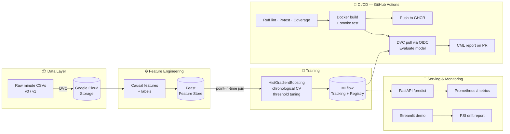

<div align="center">

# 📈 Stock Movement Predictor
### End-to-End MLOps Pipeline for Intraday Stock Price Direction Forecasting

[](https://github.com/Udghosh-Rao/stock-prediction-mlops-pipeline/actions/workflows/ci.yml)


**Versioned data → Feature store → Experiment tracking → Model registry → CI/CD → Containerized serving → Monitoring**

</div>

---

## 🎯 Overview

A machine learning system that predicts whether an NSE-listed stock's price will be **higher 5 minutes from now**,
trained on **1.6M+ minute-level OHLCV candles** across 5 equities. The model is a simple gradient-boosted
classifier; the focus is on the **ML engineering around it**: reproducibility, automation, leakage-free
evaluation, deployment and observability.

## 🏗️ Architecture



## ✨ Key Features

| Capability | Implementation |
|---|---|
| **Data Versioning** | DVC with a Google Cloud Storage remote tracks raw data versions, the CI test set and MLflow state for full reproducibility |
| **Feature Store** | Feast entity and feature view with point-in-time historical retrieval to avoid training/serving skew and label leakage |
| **Feature Engineering** | 8 causal time-series features: rolling statistics, returns, volatility, volume ratio and intraday seasonality |
| **Model Training** | Gradient boosting (`HistGradientBoostingClassifier`) with class-imbalance handling and hyperparameter tuning |
| **Leakage-Free Evaluation** | Chronological train / validation / test split, threshold tuned on validation, compared against a naive baseline |
| **Experiment Tracking** | MLflow logs parameters, metrics (Accuracy, F1, Precision, Recall, ROC-AUC), model signatures and artifacts |
| **Model Registry** | Best model registered in the MLflow Model Registry and verified in CI before evaluation |
| **CI/CD Pipeline** | GitHub Actions: lint → unit tests + coverage → Docker build → container smoke test → GHCR publish → model evaluation → CML PR report |
| **Cloud Security** | Keyless GCP authentication using Workload Identity Federation (OIDC), with no long-lived service account keys |
| **Model Serving** | FastAPI REST API with Pydantic v2 validation, OpenAPI docs, health checks and model metadata endpoint |
| **Containerization** | Docker image and Docker Compose stack (API + Streamlit + MLflow UI) |
| **Observability** | Prometheus metrics (request count, latency histogram, prediction distribution) and structured logging |
| **Drift Monitoring** | Population Stability Index (PSI) data drift detection with alert thresholds, as a CLI and in the dashboard |
| **Interactive Demo** | Streamlit app: upload any minute-candle CSV and get features, a backtest, drift analysis and a live prediction |
| **Code Quality** | Ruff linting, pre-commit hooks, Dependabot dependency updates, 17 automated tests |

## 🧪 Feature Set

All features are **causal**, meaning they use only the current and past bars. A unit test enforces this.

| Feature | Description |
|---|---|
| `rolling_avg_10` | 10-bar moving average of close |
| `volume_sum_10` | 10-bar total traded volume |
| `ret_1`, `ret_5` | 1- and 5-minute returns (momentum) |
| `price_vs_avg_10` | Deviation of price from its moving average (mean reversion) |
| `volatility_10` | Rolling standard deviation of returns |
| `volume_ratio_10` | Current volume relative to its recent average |
| `minute_of_day` | Intraday seasonality |
| `stock_encoded` | Ordinal-encoded ticker (unseen tickers handled) |

**Target:** `1` if `close(t + 5 min) > close(t)`, otherwise `0`. Bars with no observation exactly 5 minutes later are left unlabeled rather than guessed.

## 📊 Results

Baseline pipeline (2 raw features, no imbalance handling):

| Iteration | Data | Train rows | Test rows | Best F1 |
|---|---|---|---|---|
| 1 | v0 (2 stocks) | 523,180 | 146,164 | 0.1133 |
| 2 | v0 + v1 (5 stocks) | 1,231,159 | 365,434 | 0.0595 |

**Diagnosis:** raw price-level features don't carry over between stocks with different price ranges, and the model
collapsed to the majority class. The current pipeline addresses both with scale-free features, class balancing and
F1-optimal threshold tuning. Every run is compared against an always-up baseline in MLflow. Short-horizon price
direction is close to a random walk, so a ROC-AUC modestly above 0.5 is a realistic target.

## 🚀 Quickstart

### 1. Run the demo locally (no cloud credentials needed)

```bash
git clone https://github.com/Udghosh-Rao/stock-prediction-mlops-pipeline.git
cd stock-prediction-mlops-pipeline
pip install -r requirements-dev.txt
streamlit run app.py
```

Upload a CSV with `timestamp, close, volume` columns, or use the bundled [sample data](sample_data/).

### 2. Run the full stack with Docker Compose

```bash
docker compose up --build                      # API :8000 + Streamlit :8501
docker compose --profile tracking up           # + MLflow UI :5000
```

### 3. Call the prediction API

```bash
curl -X POST localhost:8000/predict -H "Content-Type: application/json" -d '{
  "stock_name": "AARTIIND",
  "candles": [{"timestamp": "2024-01-01T04:00:00Z", "close": 512.3, "volume": 1200}, "...at least 10..."]
}'
```

| Endpoint | Purpose |
|---|---|
| `POST /predict` | Probability that price is higher in 5 minutes, plus a thresholded label |
| `GET /health` | Liveness and model-loaded check |
| `GET /model-info` | Model type, features, threshold, known tickers |
| `GET /metrics` | Prometheus scrape endpoint |
| `GET /docs` | Interactive OpenAPI (Swagger) docs |

### 4. Reproduce the full pipeline (requires GCS access)

```bash
pip install -r requirements.txt
dvc pull                       # data + MLflow state from GCS
make data                      # feature engineering + feast apply
make train-1 train-2           # train, track and register models
make evaluate                  # same evaluation as CI
python -m src.monitoring --reference ref.parquet --current new.parquet   # drift check
```

## 📁 Project Structure

```
├── app.py                      # Streamlit dashboard (upload → backtest → drift → predict)
├── src/
│   ├── config.py               # Central config: features, paths, hyperparameters
│   ├── features.py             # Causal feature engineering + labelling (shared by train & serve)
│   ├── prepare_data.py         # Raw CSV → engineered Parquet
│   ├── get_training_data.py    # Feast point-in-time feature retrieval
│   ├── train.py                # Chronological split, tuning, MLflow tracking & registry
│   ├── ci_evaluate.py          # CI model evaluation + CML artifacts
│   ├── serve.py                # FastAPI inference service + Prometheus metrics
│   ├── monitoring.py           # PSI data drift detection
│   └── sample_data.py          # Synthetic market data generator
├── feature_repo/               # Feast feature store definitions
├── tests/                      # Pytest: features, leakage, splits, API, drift, data sanity
├── .github/workflows/ci.yml    # CI/CD pipeline
├── Dockerfile · docker-compose.yml · Makefile
├── .pre-commit-config.yaml · .github/dependabot.yml · pyproject.toml
└── *.dvc                       # DVC-tracked data, models and MLflow state
```

## 🛠️ Tech Stack

| Category | Tools |
|---|---|
| **Language & ML** | Python 3.12, pandas, NumPy, scikit-learn (Gradient Boosting) |
| **MLOps** | MLflow (Tracking, Model Registry), DVC, Feast, CML |
| **Cloud** | Google Cloud Platform (GCS, IAM, Workload Identity Federation) |
| **Serving** | FastAPI, Pydantic v2, Uvicorn, REST API |
| **DevOps** | Docker, Docker Compose, GitHub Actions, GitHub Container Registry |
| **Monitoring** | Prometheus metrics, PSI data drift detection, structured logging |
| **Quality** | Pytest, pytest-cov, Ruff, pre-commit, Dependabot |
| **Visualization** | Streamlit, Matplotlib |

## 👤 Author

**Udghosh Rao** · B.S. Data Science & Applications, IIT Madras
[GitHub](https://github.com/Udghosh-Rao)

<sub>Originally built for the IIT Madras BS MLOps OPPE (Roll No. 24F2000612) and extended into a production-style portfolio project.</sub>
